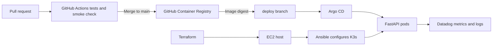

# FastAPI DevOps portfolio

A small FastAPI service with a repeatable delivery path from a pull request to a Kubernetes rollout. Start with a local kind cluster. The optional cloud demo uses one Ubuntu EC2 instance running K3s.



| Path | Purpose |
| --- | --- |
| `app/`, `tests/`, `Dockerfile` | API, health probes, metrics, JSON request logs, and non-root image |
| `k8s/`, `gitops/` | Kubernetes workload and Argo CD application |
| `infra/aws/`, `ansible/` | EC2 network and host configuration |
| `infra/datadog/` | Helm values, dashboard, and alert |
| `.github/` | CI/CD and repository guidance for GitHub Copilot |

## Run locally

Use Python 3.12 for local tests. The cluster demo also needs Docker, kind, kubectl, and curl.

```sh
python3.12 -m venv .venv
. .venv/bin/activate
python -m pip install -r requirements-dev.txt
python -m pytest -q

kind create cluster --name portfolio
docker build -t portfolio-api:local .
kind load docker-image portfolio-api:local --name portfolio
kubectl --context kind-portfolio create namespace portfolio
kubectl --context kind-portfolio -n portfolio apply -k k8s
kubectl --context kind-portfolio -n portfolio rollout status deployment/portfolio-api
kubectl --context kind-portfolio -n portfolio port-forward svc/portfolio-api 8080:8080
```

In another terminal:

```sh
curl -fsS http://127.0.0.1:8080/
curl -fsS http://127.0.0.1:8080/readyz
curl -fsS http://127.0.0.1:8080/metrics | rg portfolio_http
kubectl --context kind-portfolio -n portfolio logs -l app=portfolio-api --tail=20
```

Stop port-forwarding and run `kind delete cluster --name portfolio` when finished.

## Publish and deploy

1. From this directory, initialize Git and make the first commit. Run the final command only when ready for the source code to be public. It needs the authenticated GitHub CLI.
   ```sh
   git init -b main
   git add .
   git commit -m "Build FastAPI DevOps portfolio"
   gh auth login
   gh repo create fastapi-devops-portfolio --public --source=. --remote=origin --push
   ```
2. Wait for **Validate and release** to pass in the GitHub Actions tab. The workflow checks the app, builds and runs the container, pushes to GHCR, and updates the generated `deploy` branch. Set the repository's container package visibility to **Public** in its package settings so this demo cluster can pull anonymously. Use a dedicated repository and reserve the `deploy` branch for releases and rollbacks. The GitHub token in the release job needs permission to write the package and branch. [GHCR permissions](https://docs.github.com/en/packages/learn-github-packages/configuring-a-packages-access-control-and-visibility)
3. Use a fresh cluster with the desired kubeconfig and context. Install Argo CD using a reviewed, pinned release tag from the upstream project. Substitute the tag in the command below. The server stays accessible through local port forwarding when needed.
   ```sh
   ARGO_VERSION='REPLACE_WITH_RELEASE_TAG'
   kubectl create namespace argocd
   kubectl apply --server-side -n argocd -f "https://raw.githubusercontent.com/argoproj/argo-cd/$ARGO_VERSION/manifests/install.yaml"
   kubectl -n argocd rollout status deployment/argocd-repo-server
   REPO_URL='https://github.com/OWNER/REPO.git'
   sed "s|https://github.com/OWNER/REPO.git|$REPO_URL|" gitops/application.yaml | kubectl apply -f -
   kubectl -n argocd get application portfolio-api
   kubectl -n portfolio rollout status deployment/portfolio-api
   kubectl -n portfolio port-forward svc/portfolio-api 8080:8080
   ```
   Allow time for Argo to create the namespace and Deployment before checking rollout status. Check the application status for sync errors. Use the same smoke checks as above with the selected cluster context. [Argo CD installation](https://argo-cd.readthedocs.io/en/stable/getting_started/) · [Automated sync](https://argo-cd.readthedocs.io/en/stable/user-guide/auto_sync/)
4. Merge a small app change through a pull request. Verify the new digest on `deploy` matches the Deployment's image and the Argo CD application reports `Synced` and `Healthy`.
   ```sh
   git fetch origin deploy
   git show FETCH_HEAD:k8s/kustomization.yaml
   kubectl -n portfolio get deployment portfolio-api -o jsonpath='{.spec.template.spec.containers[0].image}'
   ```

### Roll back

Pause new merges and reruns while rolling back. Use a clean checkout with push access. Identify the bad deployment commit in the generated branch, then revert it. Argo CD reconciles the previous digest from Git. Keep the previous image in GHCR. This applies when a previous healthy release exists.

```sh
git fetch origin deploy
git switch -c rollback FETCH_HEAD
git log -5 --oneline
git revert BAD_DEPLOY_COMMIT
git push origin HEAD:deploy
kubectl -n argocd get application portfolio-api
kubectl -n portfolio rollout status deployment/portfolio-api
git switch main
```

## Optional AWS demo

Prerequisites include AWS credentials authorized to create the listed resources, Terraform, Ansible, SSH, and a supported K3s release tag. EC2, storage, and public IPv4 can incur charges. The single node is a demo topology. Both pods can run on the same host.

```sh
export TF_VAR_ssh_cidr='YOUR_PUBLIC_IPV4/32'
export TF_VAR_ssh_public_key="$(cat ~/.ssh/id_ed25519.pub)"
terraform -chdir=infra/aws init
terraform -chdir=infra/aws plan -out=demo.tfplan
terraform -chdir=infra/aws apply demo.tfplan
HOST="$(terraform -chdir=infra/aws output -raw public_ip)"
```

Verify the instance SSH host fingerprint over a trusted channel such as EC2 console output on first connection. Keep Ansible host key checking enabled. Replace the version below using a supported release from the [K3s releases page](https://github.com/k3s-io/k3s/releases). The official installer downloads the versioned binary and verifies its checksum. [K3s configuration](https://docs.k3s.io/installation/configuration)

```sh
ssh "ubuntu@$HOST" true
ansible-playbook -i "$HOST," -u ubuntu ansible/site.yml -e 'k3s_version=REPLACE_WITH_RELEASE_TAG'
```

Copy the admin kubeconfig into a private temporary directory. Replace its localhost API port to match the tunnel. Keep the SSH tunnel running in a dedicated terminal.

```sh
KUBE_DIR="$(mktemp -d)"
export KUBECONFIG="$KUBE_DIR/config"
(umask 077; ssh "ubuntu@$HOST" sudo cat /etc/rancher/k3s/k3s.yaml > "$KUBECONFIG")
sed 's|https://127.0.0.1:6443|https://127.0.0.1:16443|' "$KUBECONFIG" > "$KUBE_DIR/config.new"
cat "$KUBE_DIR/config.new" > "$KUBECONFIG"
rm "$KUBE_DIR/config.new"
ssh -fNT -o ExitOnForwardFailure=yes -L 127.0.0.1:16443:127.0.0.1:6443 "ubuntu@$HOST"
kubectl get nodes
```

Run the Argo CD install and deployment steps against this context. When finished, remove Datadog resources first if installed, run `terraform -chdir=infra/aws destroy`, close the tunnel, remove the temporary kubeconfig, and unset `KUBECONFIG`.

## Datadog dashboard, logs, and alert

Use Helm and a Datadog account with scoped API/application credentials for Terraform. Check Datadog billing for Kubernetes infrastructure, logs, and custom metrics. The Helm command below uses the kind containerd socket. For K3s, replace the socket path with `/run/k3s/containerd/containerd.sock`. Set your site's domain and choose a reviewed chart version. Load `DD_API_KEY` and `DD_APP_KEY` into your shell from a secret manager, without printing either value.

```sh
DD_SITE='datadoghq.com'
DD_CHART_VERSION='REPLACE_WITH_CHART_VERSION'
kubectl create namespace datadog
printf '%s' "$DD_API_KEY" | kubectl -n datadog create secret generic datadog-api-key --from-file=api-key=/dev/stdin
helm repo add datadog https://helm.datadoghq.com
helm repo update
helm upgrade --install datadog datadog/datadog -n datadog \
  --version "$DD_CHART_VERSION" -f infra/datadog/agent-values.yaml --set "datadog.site=$DD_SITE" --set "datadog.criSocketPath=/run/containerd/containerd.sock"
export DD_HOST="https://api.$DD_SITE"
terraform -chdir=infra/datadog init
terraform -chdir=infra/datadog plan -out=demo.tfplan
terraform -chdir=infra/datadog apply demo.tfplan
```

After the Agent starts, send a few requests to both `/` and `/missing` over the port forward. Repeat after the first scrape so the Datadog counter has a baseline. Use **Portfolio API** to inspect request counts by status class. In Logs Explorer filter `service:portfolio-api env:portfolio @event:http_request` and inspect `status` and `duration_ms`. The monitor is configured to alert on more than five HTTP 5xx responses over five minutes. Its notification appears in Datadog. Set a notification destination in the Terraform monitor message if you want external delivery. To exercise the monitor query safely, temporarily change the status filter to `4xx` in a dedicated demo environment, generate missing-route traffic across multiple scrapes, verify the alert, and restore `5xx`. [OpenMetrics naming](https://docs.datadoghq.com/integrations/openmetrics/) · [Kubernetes Autodiscovery](https://docs.datadoghq.com/containers/kubernetes/integrations/)

To clean up, run `terraform -chdir=infra/datadog destroy`, `helm uninstall datadog -n datadog`, and `kubectl delete namespace datadog` if that namespace was created only for this demo. Clear credential variables from your shell.

## Work with GitHub Copilot

Open the published repository in a Copilot-enabled editor or on GitHub. The repository instructions describe its tests, deployment constraints, and logging conventions. On a feature branch, ask Copilot to update the service response and adjust the tests, or ask it to review a pull request for permissions and deployment regressions. Review the proposed changes and run tests before merging. Use the resulting CI run, Argo CD sync, Datadog graphs, and rollback evidence in your portfolio. [Repository custom instructions](https://docs.github.com/en/copilot/how-tos/copilot-on-github/customize-copilot/add-custom-instructions/add-repository-instructions)

A portfolio project demonstrates hands-on DevOps skills. It does not prove one year of paid professional DevOps experience. Document any qualifying employment separately with accurate dates, role, and responsibilities.
